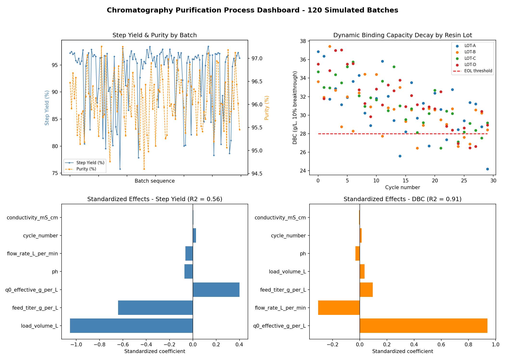

# Chromatography Purification Simulator

A synthetic bioprocess purification pipeline: Thomas-model breakthrough
curves -> batch generation with noise & resin aging -> SQLite
ETL -> statistical analysis (regression + resin decay fit) -> dashboard.

## Run order
```
python3 batch_generator.py   # generates data/batches.csv, data/runs/*.csv
python3 etl.py                # builds chrom_sim.db (batches, run_curves, kpis)
python3 analysis.py           # prints regression effects & resin decay fit
python3 dashboard.py          # writes dashboard.png
```

## Key findings from this run
- Dynamic binding capacity (DBC) is driven almost entirely by resin
  binding capacity itself (R2 = 0.91), as expected physically.
- Step yield (R2 = 0.56) is dominated by load volume relative to
  breakthrough volume -- overloading past breakthrough is the main
  yield-loss lever.
- All four resin lots show clear DBC decay with cycle number and are
  projected to cross the 28 g/L end-of-life threshold around cycle 28-30.

<p align="center">
  
</p>


## Files
- thomas_model.py    -- core breakthrough curve physics
- batch_generator.py -- synthetic batch/curve data generation
- etl.py             -- SQLite schema + load (batches, run_curves, kpis)
- analysis.py         -- regression effects + resin decay fit
- dashboard.py        -- matplotlib dashboard (dashboard.png)
- chrom_sim.db        -- built SQLite database
- batches.csv         -- flat batch-level table (for quick inspection)
