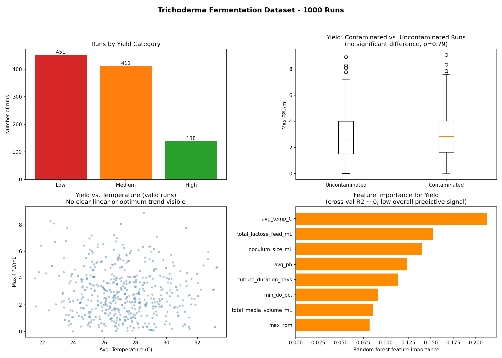

# Trichoderma Fermentation Optimization Analysis

Real dataset: 1000 fungal (Trichoderma) cellulase fermentation runs,
sourced from Kaggle ("Fermentation optimization" -- 5L bioreactor
hybrid dataset). Yield measured as Max FPU/mL (Filter Paper Units,
a standard cellulase activity assay).

## Run order
```
python3 clean_data.py   # cleans raw data -> data/clean_runs.csv
python3 etl.py           # builds ferm_opt.db (runs table + runs_valid view)
python3 analysis.py      # prints contamination effect + yield regression
python3 dashboard.py     # writes dashboard.png
```

## Data quality issues found and handled
1. **Duplicate Run_ID**: TRICH_15 appeared twice with different process
   conditions -- a real ID-collision bug upstream. Disambiguated rather
   than dropped, since both rows are real observations.
2. **144/1000 rows (14.4%) had negative Max FPU/mL** -- physically
   impossible for an enzyme activity assay. Treated as assay measurement
   noise around a true value near zero (common for blank-subtracted
   colorimetric assays on low/failed runs). Floored at 0 for magnitude
   analysis, but flagged in `fpu_measurement_flag` rather than discarded.
3. **Inconsistent yield-category text**: "Low yeild" / "Medium Yeild" /
   "High Yeild" / "Medium yeild" -- misspelling + inconsistent casing.
   Standardized to a clean `Low` / `Medium` / `High` categorical.
4. **Contamination (Y/N)** converted to boolean.

## Findings (reported honestly, including the negative result)
- **Contamination shows no statistically significant effect on yield**
  in this dataset (mean FPU: 2.89 uncontaminated vs. 2.92 contaminated,
  p = 0.79). This is a genuine, somewhat counterintuitive finding worth
  noting rather than assuming contamination always hurts yield.
- **No single process parameter meaningfully predicts yield** in this
  dataset. Tested linear regression (R2 = 0.03), regression with
  quadratic/"sweet spot" terms (R2 = 0.055), and a random forest with
  5-fold cross-validation (mean CV R2 ~ 0, i.e. no better than the mean).
  This was checked deliberately rather than stopping at a weak linear
  result -- the conclusion is that recorded process parameters carry
  very little signal for yield in this dataset, most likely due to
  unmeasured confounds (e.g. starter culture health, strain lot,
  unrecorded feeding schedule) or measurement noise dominating the
  batch-level summary stats provided.

  


## Files
- clean_data.py    -- documented data cleaning (see issues above)
- etl.py           -- SQLite schema + a `runs_valid` view
- analysis.py      -- contamination t-test + yield-driver regression
- dashboard.py     -- matplotlib dashboard (dashboard.png)
- ferm_opt.db      -- built SQLite database
- clean_runs.csv   -- cleaned flat table
